In this lab our task was to detect the 8 classes of: `person`, `bicycle`, `car`, `van`, `truck`, `tricycle`, `bus`, `motor` and their bounding boxes from frames of aerial drone footage, evaluated using $mAP@[0.50:0.95]$, $AP_{50}$, $AP_{\text{small}}$

## Data understanding/exploration
Here are the some of the data properties we explored:
- aspect ratio - all frames are 16:9, roughly 69% are at least 1080p in resolution, which means downscaling is bad
- class distribution - cars make up 45.7% of objects, humans - 29.7%, making up roughly 75% of all data
- object sizes - small objects with area < 1024px$^2$ (32x32) make up roughly 25% of data, medium 1024px$^2$ - 9216px$^2$ - 64%, > 9216px$^2$ (96x96) - 11%
- ignored regions - there are roughly 64 thousand ignored regions, ~47% of them are in the top quarter of the screen, usually indicating tiny far away objects
- optical flow - since all frame batches are continuous we can use optical flow to construct flow vectors between images and transfer bounding boxes between frames
- subsampling - frames are from a continuous video recording, in a single clip, most of them are nearly identical, therefore we can subsample at k = 3, retaining most data but cutting training time significantly
## Preprocessing
Here are the post pre processing we do in our pipeline:
- class remapping - visdrone has 12 classes but we only detect 8
- ignored regions - we ignore them
- aspect ration handling - for most models we do letterboxing at 640x640 or 1024x1024 and scale the image up/down to fit it, while preserving the aspect ratio and then pad the rest of the space with a constant gray color
- color normalization - reordering channels from opencv's bgr to rgb, rescaling pixel scalar values to 0-1 float values, standard imagenet normalization, changing the shape from (height, width, channels) to (channels, height, width)
- augmentations - adding random zoom crops, horizontal flips, affine transformations, brightness contrast changes, hue saturation changes, motion blur, and mosaic/mixups to increase training data variety
## Two Stage Anchor Based
For this part we used Faster RCNN, which has two parts:
- region proposal network (RPN)
- RoIAlign heads (ResNet-50-FPN V2)

The base model scored $mAP$ = 0.2650, $AP_{50}$ = 0.6014, $AP_{\text{small}}$ = 0.1407.

The two experiments I did were:
- experiment 1 - expanding the number of proposals (number of candidate objects) from 2000 to 3000 on the training dataset and from 1000 to 1500 on the validation dataset. This resulted in $mAP$ = 0.2904, $AP_{50}$ = 0.6089, $AP_{\text{small}}$ = 0.1534, which is the best out of three
- experiment 2 - keeping the same tuned proposals as experiment 1, but now with sharpening the L1 transition parameter from 0.111 to 0.02, which forced a larger penalty on small objects, and adding label smoothing at 0.05 to cross-entropy, which should help better predict similar looking classes like vehicles. This resulted in $mAP$ = 0.2433, $AP_{50}$ = 0.5478, $AP_{\text{small}}$ = 0.1728, which is worse overall, but slightly better for smaller objects

The experiment 1 model ended up receiving a 0.25488 score on kaggle, which even beat a previous query based model at the time.

Seeing as this only trained for ~90minutes, I wanted to improve on the model and tried training it for 8 epochs for 8 hours at a higher resolution (1024x1024), altered anchors, differential learning rate, but it ended up scoring only and 0.21477 on kaggle. A second attempt at this, with the standard anchors, proper learning rate with cosine annealing, trained for the same amount still produced just 0.21891 on kaggle, so we gave up on it in favor of a better query based model.
## One Stage Anchor Based
For this part we used the ResNet-50-FPN V2 model from the two staged approach, but well without the proposal stage.

The baseline model achieved $mAP$ = 0.1421, $AP_{50}$ = 0.4179.

- experiment 1 - adding micro anchors 16$^2$-256$^2$px and expanded anchor aspect ratios from 3 to 5 and increasing anchor density, this resulted in $mAP$ = 0.1043 ($AP_{50}$ = 0.2839)
- experiment 2 - setting focal loss $\alpha$ =0.35, $\gamma$ =2.0 partially improved to $mAP$ = 0.1196 $AP_{50}$ = 0.3419

The baseline came out on top and resulted in a kaggle submission of 0.17249, which is considerably worse than the two staged approach, not worth training further.

## One Stage Anchor Free

For this model I chose YOLO26s - the latest YOLO model. It was a conscious decision to pick it instead of an older YOLOv8. I ran multiple experiments, none of which turned out very successful.

I was really betting on this model at the start, so I added a QUICK_TEST option to my notebook config for quick experiments. If it's true, the stride is increased to 15 and the model is only trained on first 10% of the dataset (this was later removed since it decreased the valuable variety of training data. I increased stride instead). This let me do quick experiments with 10 epochs running in ~10 minutes instead of a few hours.

Below you can see my experiments with this setting on:

### Test 1 (1024x1024 px)

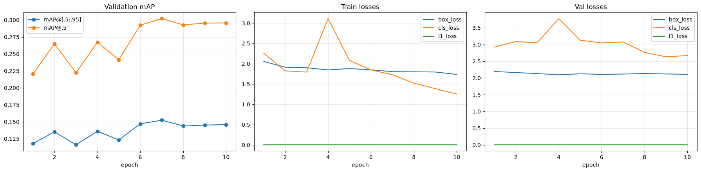

### Test 2 (640x640 px)

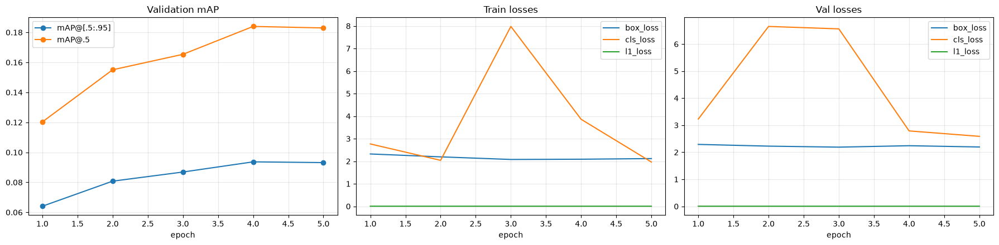

Results were obviously worse so all future tests use 1024x1024 px.

### Test 3 (disabled NMS)

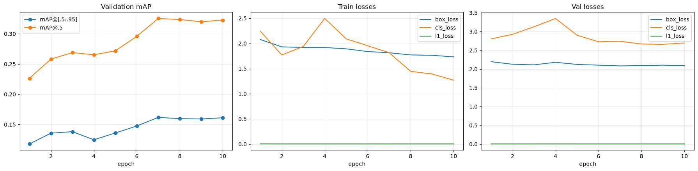

YOLO26s predicts with its own one-to-one head, meaning it already predicts a single box for an object, so it doesn't need NMS.

### Test 4 (P2 head)

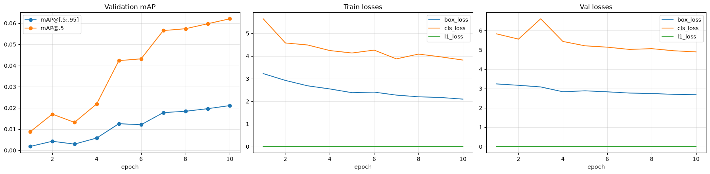

Here I tried out enabling the forth P2 head of the YOLO model. Results look bad, but it's only because it probably takes longer to converge. A bit too long, in fact.

### Test 5 (same params as test 1 + ignore mask)

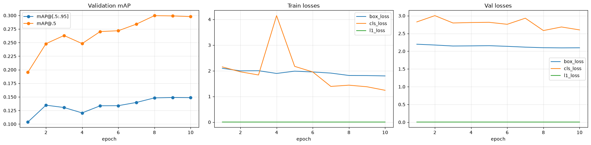

I added an ignore mask which masks ignored regions on the training images, so the model doesn't get negative feedback for predicting objects that might still be there in the crowd

### Full run (test 4's config)

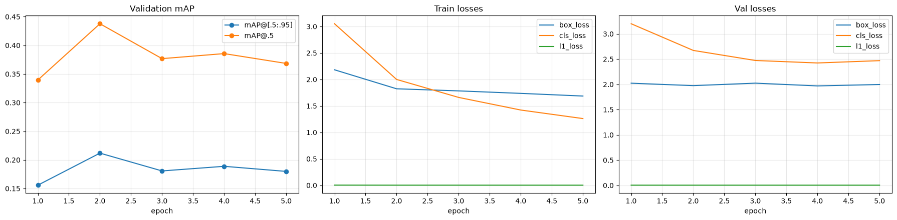

Unfortunately, I didn't disable early stopping and the overnight run was finished before it could train for the full 20 epochs. I didn't try again since it wasn't possible to resume a run that's finished due to early stopping, and I wanted to compare the results of a no P2 model on a full proper run, since I was suspecting my QUICK_TEST runs weren't very reliable.

### Full run (test 1's config)

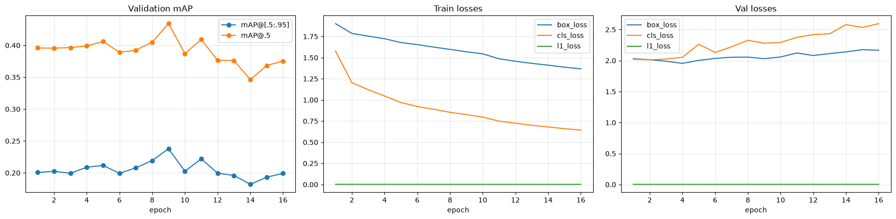

The results of this run appeared really weird to me. But besides, you can clearly see the model was overfitting aggressively judging by diminishing train losses and rising val losses.

At this point I abandoned YOLO and continued my search for the endgame model.

## Query-based model

My first choice for the query-based model was RT-DETR-L. I trained it for ~6 hours, but it didn't produce any impressive results (~0.22 mAP on public leaderboard). Probably because the training image resolution was too low: only 640x640 px. I also saw no improvements after 15 epochs of training, so this first run taught me not to plan for this many epochs at the start. 

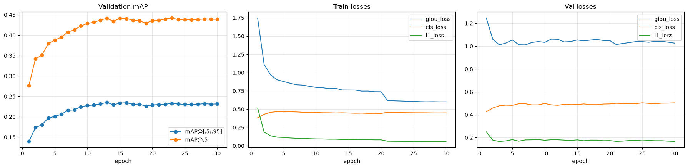

The dip you can see in the Train losses graph at around 20th epoch is caused by Ultralytics image augmentation being turned off when less than 10 epochs of training are left, so the model quickly learns to predict the exact images it now sees in the training set. Before that, image augmentation was turned on, so the model didn't really see the exact images of the training set. Augmentation included flipping, color modification and patching, but was ultimately provided by Ultralytics contrary to a custom algorithm.

### Switching to D-FINE

I could tweak the parameters and probably get far better results out of this model, but after searching for "what's the best model for predicting the VisDrone dataset???" on Google I changed my mind and decided to train another query-based model instead - D-FINE. Their graphs on Github looked really impressive and blew RT-DETR out of the water.

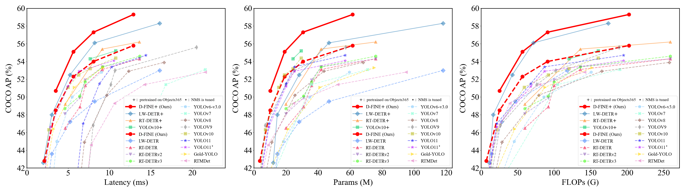

My first run was on a COCO-pretrained D-FINE-M (20 mil params) with image resolution increased to 1024x1024. Right away - much better results: 0.3 on public leaderboard.

Then I got some very good news: it turned out that I had an RX 7800 XT I could use for local training with 16 GB of VRAM (instead of RTX 3070 8 GB I was using earlier), so this let me upgrade to D-FINE-L (30 mil params), and even increase my image resolution further to 896x1600 px. Other improvements I made on the next run are:

- Mask ignored regions on the training images, so the model doesn't get negative feedback for predicting objects that might still be there in the crowd
- Decrease learning rate (previous run overfitted quickly)
- In addition to (this time custom-implemented) generic image augmentation, I have downscaled 20% of the training images. Reasoning is that the test set contains a lot of low-res frames, while the training and validation sets almost have none, so this would help the model to learn to correctly detect blurred objects (because everything gets rescaled to 896x1600 during training and inference)

This gave even better results: 0.33 on the public leaderboard.

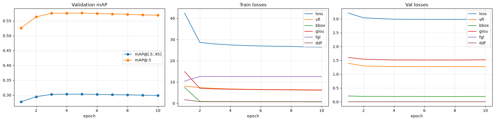

To make the submission, I used the model as it was at the 4th epoch, as it was deemed "best" in terms of mAP score for validation. You can see that it only decreases slightly afterwards on the graph. But I was still suspecting this could be false for the test set, especially since validation and test sets contain very different frame resolution distributions. So I tried predicting using the model at its last epoch state, and, sure enough, the score improved quite a lot (+0.12):

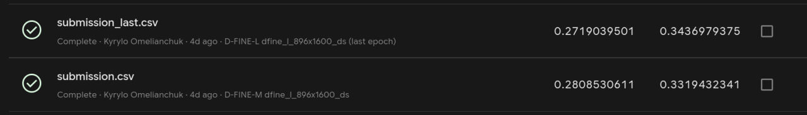

It's only now that I see the original submission had much higher private score (+0.1). I feel betrayed. Nevertheless, the submission_last.csv model ended up what we used for our final pipeline to build upon. Unfortunately.

## Our Pipeline

Basically what my "postprocessing" in the pipeline does is it divides every frame into 4 tiles, scales them up and predicts (using the loaded model) on them so small objects become bigger. Also, in addition to predicting on the test dataset, i also predict on its mirrored version, and then combine the predictions using WBF. And also temporal rescoring which simply raises the confidence score for a box in a frame if there are same boxes nearby in frames +-n and decreases it if there aren't. It's pretty basic. This is all I do in the pipeline, so all these changes are inference-time.

I decided not to build an ensemble since D-FINE was clearly way ahead of all of the other models we trained and they would only add noise. The only thing D-FINE still struggled the most with were small objects (mAP small was <0.16), but we weren't able to train a model that could improve on that specific task. Instead, to help with small objects, I use tiling, as I already explained.

### Results

During parameter search on validation set which can be seen in the notebook, it seemed that temporal rescoring was yielding minimal results no matter the window size or weight.

I still tried submitting with the best settings ("window": 2, "iou_thr": 0.5, "weight": 0.3) and it gave a subtly better result on public leaderboard, but on private it only harmed it. A lot. (0.295 without TR, 0.289 with)

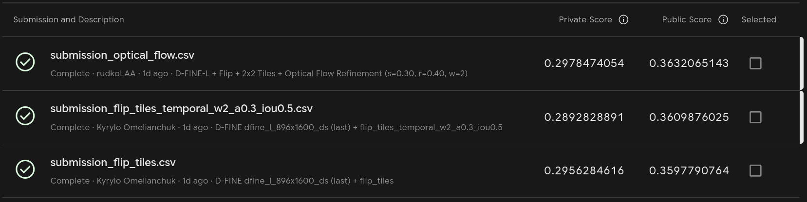

Thankfully, we also tried implementing optical flow in the pipeline, and it gave promising results, helping us secure 5th place.

## Summary

| Checkpoint | Model | Latency | Val $mAP_{50:95}$ | Val $AP_{50}$ | Kaggle score |
| - | - | - | - | - | - |
| Two Stage | Faster R-CNN ResNet-50-FPN V2 | 393.7 ms | 0.2904 | 0.6089 | 0.25488 |
| One Stage Anchor | RetinaNet ResNet-50-FPN V2 | 191.6 ms | 0.1421 | 0.4179 | 0.17249 |
| One Stage Free | YOLO26s | 8.9 ms | 0.2006 | 0.3762 | 0.22231 |
| Query Based | RT-DETR-L | 14.8 ms | 0.2391 | 0.4489 | 0.22975 |
| Base D-Fine | D-FINE-L | 45.6 ms | 0.3031 | 0.5762 | 0.34370 |
| Full Pipeline | D-FINE-L + Flip + Tiles + Optical Flow | 205.0 ms | * | * | 0.36321 |

\* not validated on full validation set due to time being a scarce resource.

NO AI WAS USED IN THE MAKING OF THIS REPORT!!!!!!!!!!!!
